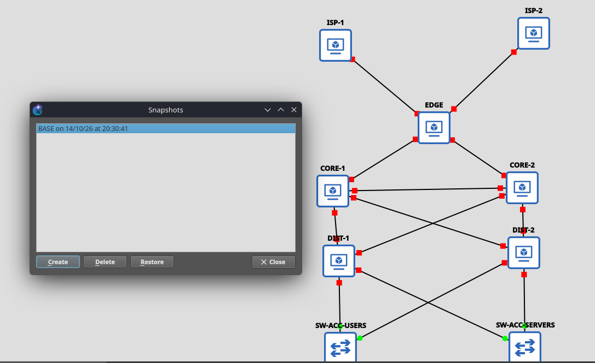

# Memoria del Laboratorio — Failover Routing

**Grupo:** 12
**Materia:** Gestión Operativa y Seguridad en Redes (GOYS), UTN FRLP
**Fecha de entrega:** viernes 23/10/2026 (F4 y F5 entregadas con atraso, ver 6.1)

## Integrantes y roles

| Integrante | Rol | Routers |
|-----------|-----|---------|
| Serra Facundo | R1 — Líder / Edge-WAN | EDGE |
| Espamer Martín | R2 — Proveedores | ISP-1, ISP-2 |
| Rebol Manuel | R3 — Core | CORE-1, CORE-2 |
| Molteni Baltazar | R4 — Distribución | DIST-1, DIST-2 |
| Manrique Agustín | R5 — Hosts / QA / Operación | PC-USER, SRV |

La consigna pide rotación R1↔R2 en F4. No se cumplió como estaba previsto: los drills de F4 se ejecutaron desde la máquina de R1. Los runbooks quedan asignados por rol y cada integrante defiende el de su capa.

---

## 1. Diseño (F0)

El diseño completo, con su justificación, está en [`docs/F0.md`](F0.md). Acá va el resumen.

### 1.1 Corrección del diagrama

El diagrama "Enterprise Network Design (Cisco)" tiene 5 defectos. Corregimos cuatro en el lab y el quinto (firewall sin par HA) lo dejamos documentado como limitación.

| # | Defecto detectado | Corrección aplicada | Justificación |
|:-:|-------------------|---------------------|---------------|
| 1 | Firewall único, sin par HA (SPOF) | Se documenta. En producción irían dos firewalls en failover activo/pasivo con sincronización de estado. El lab mantiene un solo EDGE, que también es SPOF. | Un único firewall es un punto único de falla. Si cae, se corta toda la salida. Lo mismo pasa con el EDGE del lab: la redundancia de ISP no cubre la caída del propio router de borde. Lo registramos como limitación conocida porque el lab ya demuestra redundancia en las demás capas. |
| 2 | Subredes solapadas entre sitios | Plan de direccionamiento sin overlap (sección 2), con un /30 distinto por enlace y un /24 distinto por LAN. | Con subredes solapadas el ruteo es ambiguo y OSPF/BGP no pueden elegir el camino correcto. |
| 3 | Sin enlace core-core | Agregamos el enlace CORE-1 ↔ CORE-2, con /30 propio y adyacencia OSPF en área 0. | Sin ese enlace, si cae el enlace de un core hacia una distribución, el tráfico no tiene camino alternativo entre cores. Con él, cada core alcanza al otro directamente y hay un camino de respaldo. |
| 4 | HSRP en el core (diseño "collapsed") | El FHRP pasa a distribución con VRRP. El core queda como tránsito puro, solo OSPF y sin gateways. | Si el core hace de gateway y de tránsito, una falla de gateway afecta al tránsito y el diagnóstico se complica. Separar capas achica cada dominio de falla. VRRP es un estándar abierto del IETF, HSRP es propietario de Cisco. |
| 5 | iBGP con route-reflector mal ubicado | eBGP directo EDGE ↔ ISP-1 y EDGE ↔ ISP-2 (AS 65000 contra 65001 y 65002), sin route-reflector. | Un route-reflector solo tiene sentido con varios routers iBGP dentro del mismo AS. Nuestro AS tiene un único router BGP, así que no hay sesiones iBGP que reflejar. El multi-homing se resuelve con dos sesiones eBGP en el borde. |

### 1.2 Plan de direccionamiento (IPAM)

Bloques sin solapamiento: enlaces a ISP `203.0.113.0/29`, enlaces internos `10.0.0.0/24` (un /30 por enlace), loopbacks `10.255.0.0/24`, LAN USERS `192.168.10.0/24`, LAN SERVERS `192.168.20.0/24` e "Internet" simulada `198.51.100.0/24`.

| Enlace / Red | Subred | Dispositivo A (IP / iface) | Dispositivo B (IP / iface) |
|--------------|:------:|----------------------------|----------------------------|
| ISP-1 ↔ EDGE | 203.0.113.0/30 | ISP-1 `.1` / ether1 | EDGE `.2` / ether1 |
| ISP-2 ↔ EDGE | 203.0.113.4/30 | ISP-2 `.5` / ether1 | EDGE `.6` / ether2 |
| EDGE ↔ CORE-1 | 10.0.0.0/30 | EDGE `.1` / ether3 | CORE-1 `.2` / ether1 |
| EDGE ↔ CORE-2 | 10.0.0.4/30 | EDGE `.5` / ether4 | CORE-2 `.6` / ether1 |
| CORE-1 ↔ CORE-2 (core-core) | 10.0.0.8/30 | CORE-1 `.9` / ether2 | CORE-2 `.10` / ether2 |
| CORE-1 ↔ DIST-1 | 10.0.0.12/30 | CORE-1 `.13` / ether3 | DIST-1 `.14` / ether1 |
| CORE-1 ↔ DIST-2 | 10.0.0.16/30 | CORE-1 `.17` / ether4 | DIST-2 `.18` / ether1 |
| CORE-2 ↔ DIST-1 | 10.0.0.20/30 | CORE-2 `.21` / ether3 | DIST-1 `.22` / ether2 |
| CORE-2 ↔ DIST-2 | 10.0.0.24/30 | CORE-2 `.25` / ether4 | DIST-2 `.26` / ether2 |
| USERS (gateway VRRP) | 192.168.10.0/24 | DIST-1 `.2` / ether3 · DIST-2 `.3` / ether3 | PC-USER `.10` / eth0 · VIP `.1` |
| SERVERS (gateway VRRP) | 192.168.20.0/24 | DIST-1 `.2` / ether4 · DIST-2 `.3` / ether4 | SRV `.10` / eth0 · VIP `.1` |

**VRRP:**

| Grupo | VRID | Versión | Master | Priority (master / backup) | IP virtual |
|-------|:----:|:-------:|:------:|:--------------------------:|:----------:|
| USERS | 10 | v2 (RFC 3768) | DIST-1 | 200 / 100 | 192.168.10.1/32 |
| SERVERS | 20 | v2 (RFC 3768) | DIST-2 | 200 / 100 | 192.168.20.1/32 |

**Router-IDs y loopbacks:**

| Nodo | Router-ID / Loopback | AS |
|------|:--------------------:|:--:|
| EDGE | 10.255.0.1/32 | 65000 |
| CORE-1 | 10.255.0.2/32 | - |
| CORE-2 | 10.255.0.3/32 | - |
| DIST-1 | 10.255.0.4/32 | - |
| DIST-2 | 10.255.0.5/32 | - |
| ISP-1 | 10.255.0.11/32 · "Internet": 198.51.100.1/32 y 198.51.100.100/32 | 65001 |
| ISP-2 | 10.255.0.12/32 · "Internet": 198.51.100.2/32 y 198.51.100.100/32 | 65002 |

### 1.3 Política de seguridad

- **Usuarios y privilegios:** `admin` (full) solo para aplicar cambios y `monitor` (read) para verificación y monitoreo. Claves distintas por usuario, fuera del repo (`secrets.txt` en `.gitignore`).
- **Servicios que se deshabilitan:** telnet, ftp, www, www-ssl, api, api-ssl, winbox, reverse-proxy, MAC-server, MAC-winbox, neighbor discovery, bandwidth-server y el dhcp-client de fábrica. Queda solo ssh, restringido a `192.168.20.10/32` y `10.255.0.0/24`, y SNMP v3 desde F4.
- **Claves de autenticación:** OSPF MD5 (`K-OSPF-12`), BGP TCP-MD5 con una clave por sesión (`K-BGP-ISP1`, `K-BGP-ISP2`), VRRP v2 con `authentication=ah` (`K-VRRP-10`, `K-VRRP-20`) y SNMP v3 authPriv (`K-SNMP-AUTH`, `K-SNMP-PRIV`). En el repo solo aparecen como marcador.

### 1.4 Política de operación

- **Change log y commits:** Conventional Commits (`feat`, `fix`, `docs`, `ops`, `chore`). Cada cambio tiene su fila en el change log con fecha, responsable, motivo, cómo se revierte y commit (sección 6.1).
- **Backup:** `/export terse` de los 7 routers al cerrar cada epic y antes de cada drill, en `backups/AAAA-MM-DD_<router>_<fase>.rsc`. Lo saca `backup.py` por la consola de GNS3. Restore probado en F1 (sección 6.2).

---

## 2. Topología



```
[ INTERNET ]     ISP-1 (AS 65001)      ISP-2 (AS 65002)      eBGP
[ EDGE ]              EDGE (AS 65000)                        eBGP multi-homing + OSPF
[ CORE ]         CORE-1 ─── core-core ─── CORE-2             OSPF área 0 (tránsito puro)
[ DISTRIBUTION ]   DIST-1               DIST-2               VRRP + OSPF
[ ACCESS ]       SW-ACC-USERS + PC-USER  SW-ACC-SERVERS + SRV
```

11 nodos y 15 enlaces: 7 MikroTik CHR (RouterOS 7.23.8), 2 Ethernet switch y 2 VPCS, en GNS3.

---

## 3. Configuración

Las configuraciones están separadas en bloques por fase (F1 a F4). Lo que figura acá es lo aplicado en los routers.

### 3.1 ISP-1

Archivo: [`configs/ISP-1.rsc`](../configs/ISP-1.rsc). Claves como `<KEY>`.

```routeros
# ISP-1 (AS 65001) - dueno R2
# ===== F1: identidad + IPs =====
/system identity set name=ISP-1
/ip address add address=203.0.113.1/30 interface=ether1
/interface bridge add name=loopback comment="loopback / router-id"
/ip address add address=10.255.0.11/32 interface=loopback
/ip address add address=198.51.100.1/32 interface=loopback
/ip address add address=198.51.100.100/32 interface=loopback

# ===== F1: hardening (F0 3.1 y 3.3) =====
# Reemplazar <ADMIN_PASS> y <MONITOR_PASS> antes de pegar. Nunca commitear valores reales.
/user set admin password="<ADMIN_PASS>"
/user add name=monitor group=read password="<MONITOR_PASS>"
/ip service disable telnet,ftp,www,www-ssl,api,api-ssl,winbox,reverse-proxy
/ip service set ssh address=192.168.20.10/32,10.255.0.0/24
/tool mac-server set allowed-interface-list=none
/tool mac-server mac-winbox set allowed-interface-list=none
/tool mac-server ping set enabled=no
/ip neighbor discovery-settings set discover-interface-list=none
/tool bandwidth-server set enabled=no
/ip dns set allow-remote-requests=no
/ip dhcp-client remove [find]

# ===== F3: eBGP hacia EDGE con TCP-MD5 =====
/ip firewall address-list add list=bgp-out address=198.51.100.1/32
/ip firewall address-list add list=bgp-out address=198.51.100.100/32
/routing filter rule add chain=from-edge rule="if (dst == 192.168.10.0/24) { accept }"
/routing filter rule add chain=from-edge rule="if (dst == 192.168.20.0/24) { accept }"
/routing filter rule add chain=from-edge rule="reject"
/routing bgp instance add name=bgp1 as=65001 router-id=10.255.0.11
/routing bgp connection add name=EDGE as=65001 instance=bgp1 local.role=ebgp local.address=203.0.113.1 remote.address=203.0.113.2 remote.as=65000 tcp-md5-key="<K-BGP-ISP1>" input.filter=from-edge output.network=bgp-out output.default-originate=always

# ===== F4: SNMP v3 authPriv (F0 3.3) - LOS 7 ROUTERS (dueno: cada rol) =====
/snmp community set [find name=public] disabled=yes
/snmp community add name=goys12 security=private authentication-protocol=SHA1 encryption-protocol=AES authentication-password="<K-SNMP-AUTH>" encryption-password="<K-SNMP-PRIV>" addresses=192.168.20.10/32,10.255.0.0/24 read-access=yes write-access=no
/snmp set enabled=yes contact="Grupo 12 GOYS" location="GNS3 lab failover" trap-version=3
/snmp set trap-community=goys12

# ===== F4: ruta de vuelta hacia las LANs - ISP-1 e ISP-2 (dueno R1 por rotacion) =====
# Sin BGP el ISP no conoce las LANs. Distancia 30, detras de la ruta BGP (20).
/ip route add dst-address=192.168.10.0/24 gateway=203.0.113.2 distance=30 comment="vuelta LAN USERS"
/ip route add dst-address=192.168.20.0/24 gateway=203.0.113.2 distance=30 comment="vuelta LAN SERVERS"
```

### 3.2 ISP-2

Archivo: [`configs/ISP-2.rsc`](../configs/ISP-2.rsc). Claves como `<KEY>`.

```routeros
# ISP-2 (AS 65002) - dueno R2
# ===== F1: identidad + IPs =====
/system identity set name=ISP-2
/ip address add address=203.0.113.5/30 interface=ether1
/interface bridge add name=loopback comment="loopback / router-id"
/ip address add address=10.255.0.12/32 interface=loopback
/ip address add address=198.51.100.2/32 interface=loopback
/ip address add address=198.51.100.100/32 interface=loopback

# ===== F1: hardening (F0 3.1 y 3.3) =====
# Reemplazar <ADMIN_PASS> y <MONITOR_PASS> antes de pegar. Nunca commitear valores reales.
/user set admin password="<ADMIN_PASS>"
/user add name=monitor group=read password="<MONITOR_PASS>"
/ip service disable telnet,ftp,www,www-ssl,api,api-ssl,winbox,reverse-proxy
/ip service set ssh address=192.168.20.10/32,10.255.0.0/24
/tool mac-server set allowed-interface-list=none
/tool mac-server mac-winbox set allowed-interface-list=none
/tool mac-server ping set enabled=no
/ip neighbor discovery-settings set discover-interface-list=none
/tool bandwidth-server set enabled=no
/ip dns set allow-remote-requests=no
/ip dhcp-client remove [find]

# ===== F3: eBGP hacia EDGE con TCP-MD5 =====
/ip firewall address-list add list=bgp-out address=198.51.100.2/32
/ip firewall address-list add list=bgp-out address=198.51.100.100/32
/routing filter rule add chain=from-edge rule="if (dst == 192.168.10.0/24) { accept }"
/routing filter rule add chain=from-edge rule="if (dst == 192.168.20.0/24) { accept }"
/routing filter rule add chain=from-edge rule="reject"
/routing bgp instance add name=bgp1 as=65002 router-id=10.255.0.12
/routing bgp connection add name=EDGE as=65002 instance=bgp1 local.role=ebgp local.address=203.0.113.5 remote.address=203.0.113.6 remote.as=65000 tcp-md5-key="<K-BGP-ISP2>" input.filter=from-edge output.network=bgp-out output.default-originate=always

# ===== F4: SNMP v3 authPriv (F0 3.3) - LOS 7 ROUTERS (dueno: cada rol) =====
/snmp community set [find name=public] disabled=yes
/snmp community add name=goys12 security=private authentication-protocol=SHA1 encryption-protocol=AES authentication-password="<K-SNMP-AUTH>" encryption-password="<K-SNMP-PRIV>" addresses=192.168.20.10/32,10.255.0.0/24 read-access=yes write-access=no
/snmp set enabled=yes contact="Grupo 12 GOYS" location="GNS3 lab failover" trap-version=3
/snmp set trap-community=goys12

# ===== F4: ruta de vuelta hacia las LANs - ISP-1 e ISP-2 (dueno R1 por rotacion) =====
# Sin BGP el ISP no conoce las LANs. Distancia 30, detras de la ruta BGP (20).
/ip route add dst-address=192.168.10.0/24 gateway=203.0.113.6 distance=30 comment="vuelta LAN USERS"
/ip route add dst-address=192.168.20.0/24 gateway=203.0.113.6 distance=30 comment="vuelta LAN SERVERS"
```

### 3.3 EDGE

Archivo: [`configs/EDGE.rsc`](../configs/EDGE.rsc). Claves como `<KEY>`.

```routeros
# EDGE (AS 65000) - dueno R1
# ===== F1: identidad + IPs =====
/system identity set name=EDGE
/ip address add address=203.0.113.2/30 interface=ether1 comment=ISP-1
/ip address add address=203.0.113.6/30 interface=ether2 comment=ISP-2
/ip address add address=10.0.0.1/30 interface=ether3 comment=CORE-1
/ip address add address=10.0.0.5/30 interface=ether4 comment=CORE-2
/interface bridge add name=loopback comment="loopback / router-id"
/ip address add address=10.255.0.1/32 interface=loopback

# ===== F1: hardening (F0 3.1 y 3.3) =====
# Reemplazar <ADMIN_PASS> y <MONITOR_PASS> antes de pegar. Nunca commitear valores reales.
/user set admin password="<ADMIN_PASS>"
/user add name=monitor group=read password="<MONITOR_PASS>"
/ip service disable telnet,ftp,www,www-ssl,api,api-ssl,winbox,reverse-proxy
/ip service set ssh address=192.168.20.10/32,10.255.0.0/24
/tool mac-server set allowed-interface-list=none
/tool mac-server mac-winbox set allowed-interface-list=none
/tool mac-server ping set enabled=no
/ip neighbor discovery-settings set discover-interface-list=none
/tool bandwidth-server set enabled=no
/ip dns set allow-remote-requests=no
/ip dhcp-client remove [find]

# ===== F2: OSPF area 0 con MD5 (F0 2.4 y 3.4) =====
/routing ospf instance add name=ospf1 version=2 router-id=10.255.0.1 originate-default=if-installed
/routing ospf area add name=backbone area-id=0.0.0.0 instance=ospf1
/routing ospf interface-template add area=backbone interfaces=ether3,ether4 type=ptp auth=md5 auth-id=1 auth-key="<K-OSPF-12>"
/routing ospf interface-template add area=backbone interfaces=loopback passive

# ===== F3: eBGP multi-homing + redistribucion OSPF->BGP (F0 2.5) =====
/routing filter rule
add chain=from-isp1 rule="if (dst == 0.0.0.0/0) { set bgp-local-pref 200; accept }"
add chain=from-isp1 rule="if (dst in 198.51.100.0/24 && dst-len == 32) { set bgp-local-pref 200; accept }"
add chain=from-isp1 rule="reject"
add chain=from-isp2 rule="if (dst == 0.0.0.0/0) { set bgp-local-pref 100; accept }"
add chain=from-isp2 rule="if (dst in 198.51.100.0/24 && dst-len == 32) { set bgp-local-pref 100; accept }"
add chain=from-isp2 rule="reject"
add chain=to-isp rule="if (dst == 192.168.10.0/24) { accept }"
add chain=to-isp rule="if (dst == 192.168.20.0/24) { accept }"
add chain=to-isp rule="reject"
/routing bgp instance add name=bgp1 as=65000 router-id=10.255.0.1
/routing bgp connection
add name=ISP-1 as=65000 instance=bgp1 local.role=ebgp local.address=203.0.113.2 remote.address=203.0.113.1 remote.as=65001 tcp-md5-key="<K-BGP-ISP1>" input.filter=from-isp1 output.redistribute=ospf output.filter-chain=to-isp
add name=ISP-2 as=65000 instance=bgp1 local.role=ebgp local.address=203.0.113.6 remote.address=203.0.113.5 remote.as=65002 tcp-md5-key="<K-BGP-ISP2>" input.filter=from-isp2 output.redistribute=ospf output.filter-chain=to-isp

# ===== F3: firewall EDGE (F0 3.5) =====
/interface list add name=WAN
/interface list member add list=WAN interface=ether1
/interface list member add list=WAN interface=ether2
/ip firewall address-list
add list=mgmt address=192.168.20.10
add list=mgmt address=10.255.0.0/24
add list=bogons address=10.0.0.0/8
add list=bogons address=172.16.0.0/12
add list=bogons address=192.168.0.0/16
add list=bogons address=127.0.0.0/8
add list=bogons address=0.0.0.0/8
add list=lans address=192.168.10.0/24
add list=lans address=192.168.20.0/24
/ip firewall filter
add chain=input connection-state=established,related action=accept comment="in #1"
add chain=input connection-state=invalid action=drop comment="in #2"
add chain=input protocol=tcp dst-port=179 src-address=203.0.113.1 in-interface=ether1 action=accept comment="in #3 BGP ISP-1"
add chain=input protocol=tcp dst-port=179 src-address=203.0.113.5 in-interface=ether2 action=accept comment="in #3 BGP ISP-2"
add chain=input protocol=ospf in-interface=ether3 action=accept comment="in #4"
add chain=input protocol=ospf in-interface=ether4 action=accept comment="in #4"
add chain=input protocol=tcp dst-port=22 src-address-list=mgmt action=accept comment="in #5 ssh"
add chain=input protocol=udp dst-port=161 src-address-list=mgmt action=accept comment="in #5 snmp"
add chain=input protocol=icmp limit=10/1s,20:packet action=accept comment="in #6"
add chain=input action=drop comment="in #7"
add chain=forward connection-state=established,related action=accept comment="fw #1"
add chain=forward connection-state=invalid action=drop comment="fw #2"
add chain=forward in-interface-list=WAN src-address-list=bogons action=drop comment="fw #3 anti-spoofing"
add chain=forward src-address-list=lans out-interface-list=WAN connection-state=new action=accept comment="fw #4"
add chain=forward in-interface-list=WAN protocol=icmp action=accept comment="fw #5"
add chain=forward in-interface-list=WAN action=drop comment="fw #6"

# ===== F4: SNMP v3 authPriv (F0 3.3) - LOS 7 ROUTERS (dueno: cada rol) =====
/snmp community set [find name=public] disabled=yes
/snmp community add name=goys12 security=private authentication-protocol=SHA1 encryption-protocol=AES authentication-password="<K-SNMP-AUTH>" encryption-password="<K-SNMP-PRIV>" addresses=192.168.20.10/32,10.255.0.0/24 read-access=yes write-access=no
/snmp set enabled=yes contact="Grupo 12 GOYS" location="GNS3 lab failover" trap-version=3
/snmp set trap-community=goys12

# ===== F4: netwatch (chequeos activos) - EDGE (dueno R2 por rotacion) =====
/tool netwatch
add host=203.0.113.1 type=icmp interval=5s comment=ISP-1 up-script=":log info \"NETWATCH ISP-1 up\"" down-script=":log warning \"NETWATCH ISP-1 down\""
add host=203.0.113.5 type=icmp interval=5s comment=ISP-2 up-script=":log info \"NETWATCH ISP-2 up\"" down-script=":log warning \"NETWATCH ISP-2 down\""
add host=10.0.0.2 type=icmp interval=5s comment=CORE-1 up-script=":log info \"NETWATCH CORE-1 up\"" down-script=":log warning \"NETWATCH CORE-1 down\""
add host=10.0.0.6 type=icmp interval=5s comment=CORE-2 up-script=":log info \"NETWATCH CORE-2 up\"" down-script=":log warning \"NETWATCH CORE-2 down\""

# ===== F4: floating static con check-gateway - EDGE (dueno R2 por rotacion) =====
# Distancia 30/31: quedan detras de BGP (20). Solo se usan si BGP no aporta default.
/ip route add dst-address=0.0.0.0/0 gateway=203.0.113.1 distance=30 check-gateway=ping comment="chk-ISP1"
/ip route add dst-address=0.0.0.0/0 gateway=203.0.113.5 distance=31 check-gateway=ping comment="chk-ISP2"
```

### 3.4 CORE-1

Archivo: [`configs/CORE-1.rsc`](../configs/CORE-1.rsc). Claves como `<KEY>`.

```routeros
# CORE-1 - dueno R3
# ===== F1: identidad + IPs =====
/system identity set name=CORE-1
/ip address add address=10.0.0.2/30 interface=ether1 comment=EDGE
/ip address add address=10.0.0.9/30 interface=ether2 comment=CORE-2
/ip address add address=10.0.0.13/30 interface=ether3 comment=DIST-1
/ip address add address=10.0.0.17/30 interface=ether4 comment=DIST-2
/interface bridge add name=loopback comment="loopback / router-id"
/ip address add address=10.255.0.2/32 interface=loopback

# ===== F1: hardening (F0 3.1 y 3.3) =====
# Reemplazar <ADMIN_PASS> y <MONITOR_PASS> antes de pegar. Nunca commitear valores reales.
/user set admin password="<ADMIN_PASS>"
/user add name=monitor group=read password="<MONITOR_PASS>"
/ip service disable telnet,ftp,www,www-ssl,api,api-ssl,winbox,reverse-proxy
/ip service set ssh address=192.168.20.10/32,10.255.0.0/24
/tool mac-server set allowed-interface-list=none
/tool mac-server mac-winbox set allowed-interface-list=none
/tool mac-server ping set enabled=no
/ip neighbor discovery-settings set discover-interface-list=none
/tool bandwidth-server set enabled=no
/ip dns set allow-remote-requests=no
/ip dhcp-client remove [find]

# ===== F2: OSPF area 0 con MD5 (F0 2.4 y 3.4) =====
/routing ospf instance add name=ospf1 version=2 router-id=10.255.0.2
/routing ospf area add name=backbone area-id=0.0.0.0 instance=ospf1
/routing ospf interface-template add area=backbone interfaces=ether1,ether2,ether3,ether4 type=ptp auth=md5 auth-id=1 auth-key="<K-OSPF-12>"
/routing ospf interface-template add area=backbone interfaces=loopback passive

# ===== F3: firewall input (F0 3.5, ultimo parrafo) =====
/ip firewall address-list add list=mgmt address=192.168.20.10
/ip firewall address-list add list=mgmt address=10.255.0.0/24
/ip firewall filter
add chain=input connection-state=established,related action=accept
add chain=input connection-state=invalid action=drop
add chain=input protocol=ospf action=accept
add chain=input protocol=tcp dst-port=22 src-address-list=mgmt action=accept
add chain=input protocol=udp dst-port=161 src-address-list=mgmt action=accept
add chain=input protocol=icmp limit=10/1s,20:packet action=accept
add chain=input action=drop comment="drop resto"

# ===== F4: SNMP v3 authPriv (F0 3.3) - LOS 7 ROUTERS (dueno: cada rol) =====
/snmp community set [find name=public] disabled=yes
/snmp community add name=goys12 security=private authentication-protocol=SHA1 encryption-protocol=AES authentication-password="<K-SNMP-AUTH>" encryption-password="<K-SNMP-PRIV>" addresses=192.168.20.10/32,10.255.0.0/24 read-access=yes write-access=no
/snmp set enabled=yes contact="Grupo 12 GOYS" location="GNS3 lab failover" trap-version=3
/snmp set trap-community=goys12
```

### 3.5 CORE-2

Archivo: [`configs/CORE-2.rsc`](../configs/CORE-2.rsc). Claves como `<KEY>`.

```routeros
# CORE-2 - dueno R3
# ===== F1: identidad + IPs =====
/system identity set name=CORE-2
/ip address add address=10.0.0.6/30 interface=ether1 comment=EDGE
/ip address add address=10.0.0.10/30 interface=ether2 comment=CORE-1
/ip address add address=10.0.0.21/30 interface=ether3 comment=DIST-1
/ip address add address=10.0.0.25/30 interface=ether4 comment=DIST-2
/interface bridge add name=loopback comment="loopback / router-id"
/ip address add address=10.255.0.3/32 interface=loopback

# ===== F1: hardening (F0 3.1 y 3.3) =====
# Reemplazar <ADMIN_PASS> y <MONITOR_PASS> antes de pegar. Nunca commitear valores reales.
/user set admin password="<ADMIN_PASS>"
/user add name=monitor group=read password="<MONITOR_PASS>"
/ip service disable telnet,ftp,www,www-ssl,api,api-ssl,winbox,reverse-proxy
/ip service set ssh address=192.168.20.10/32,10.255.0.0/24
/tool mac-server set allowed-interface-list=none
/tool mac-server mac-winbox set allowed-interface-list=none
/tool mac-server ping set enabled=no
/ip neighbor discovery-settings set discover-interface-list=none
/tool bandwidth-server set enabled=no
/ip dns set allow-remote-requests=no
/ip dhcp-client remove [find]

# ===== F2: OSPF area 0 con MD5 (F0 2.4 y 3.4) =====
/routing ospf instance add name=ospf1 version=2 router-id=10.255.0.3
/routing ospf area add name=backbone area-id=0.0.0.0 instance=ospf1
/routing ospf interface-template add area=backbone interfaces=ether1,ether2,ether3,ether4 type=ptp auth=md5 auth-id=1 auth-key="<K-OSPF-12>"
/routing ospf interface-template add area=backbone interfaces=loopback passive

# ===== F3: firewall input (F0 3.5, ultimo parrafo) =====
/ip firewall address-list add list=mgmt address=192.168.20.10
/ip firewall address-list add list=mgmt address=10.255.0.0/24
/ip firewall filter
add chain=input connection-state=established,related action=accept
add chain=input connection-state=invalid action=drop
add chain=input protocol=ospf action=accept
add chain=input protocol=tcp dst-port=22 src-address-list=mgmt action=accept
add chain=input protocol=udp dst-port=161 src-address-list=mgmt action=accept
add chain=input protocol=icmp limit=10/1s,20:packet action=accept
add chain=input action=drop comment="drop resto"

# ===== F4: SNMP v3 authPriv (F0 3.3) - LOS 7 ROUTERS (dueno: cada rol) =====
/snmp community set [find name=public] disabled=yes
/snmp community add name=goys12 security=private authentication-protocol=SHA1 encryption-protocol=AES authentication-password="<K-SNMP-AUTH>" encryption-password="<K-SNMP-PRIV>" addresses=192.168.20.10/32,10.255.0.0/24 read-access=yes write-access=no
/snmp set enabled=yes contact="Grupo 12 GOYS" location="GNS3 lab failover" trap-version=3
/snmp set trap-community=goys12
```

### 3.6 DIST-1

Archivo: [`configs/DIST-1.rsc`](../configs/DIST-1.rsc). Claves como `<KEY>`.

```routeros
# DIST-1 - dueno R4
# ===== F1: identidad + IPs =====
/system identity set name=DIST-1
/ip address add address=10.0.0.14/30 interface=ether1 comment=CORE-1
/ip address add address=10.0.0.22/30 interface=ether2 comment=CORE-2
/ip address add address=192.168.10.2/24 interface=ether3 comment=USERS
/ip address add address=192.168.20.2/24 interface=ether4 comment=SERVERS
/interface bridge add name=loopback comment="loopback / router-id"
/ip address add address=10.255.0.4/32 interface=loopback

# ===== F1: hardening (F0 3.1 y 3.3) =====
# Reemplazar <ADMIN_PASS> y <MONITOR_PASS> antes de pegar. Nunca commitear valores reales.
/user set admin password="<ADMIN_PASS>"
/user add name=monitor group=read password="<MONITOR_PASS>"
/ip service disable telnet,ftp,www,www-ssl,api,api-ssl,winbox,reverse-proxy
/ip service set ssh address=192.168.20.10/32,10.255.0.0/24
/tool mac-server set allowed-interface-list=none
/tool mac-server mac-winbox set allowed-interface-list=none
/tool mac-server ping set enabled=no
/ip neighbor discovery-settings set discover-interface-list=none
/tool bandwidth-server set enabled=no
/ip dns set allow-remote-requests=no
/ip dhcp-client remove [find]

# ===== F2: VRRP v2 con auth AH (F0 2.2 y 3.4) =====
/interface vrrp add name=vrrp10 interface=ether3 vrid=10 version=2 priority=200 authentication=ah password="<K-VRRP-10>"
/interface vrrp add name=vrrp20 interface=ether4 vrid=20 version=2 priority=100 authentication=ah password="<K-VRRP-20>"
/ip address add address=192.168.10.1/32 interface=vrrp10
/ip address add address=192.168.20.1/32 interface=vrrp20

# ===== F2: OSPF area 0 con MD5 (F0 2.4 y 3.4) =====
/routing ospf instance add name=ospf1 version=2 router-id=10.255.0.4
/routing ospf area add name=backbone area-id=0.0.0.0 instance=ospf1
/routing ospf interface-template add area=backbone interfaces=ether1,ether2 type=ptp auth=md5 auth-id=1 auth-key="<K-OSPF-12>"
/routing ospf interface-template add area=backbone interfaces=loopback,ether3,ether4 passive

# ===== F3: firewall input (F0 3.5, ultimo parrafo) =====
# Con authentication=ah el VRRP viaja como IP 51 (AH), no como 112: el filtro va por ipsec-ah.
/ip firewall address-list add list=mgmt address=192.168.20.10
/ip firewall address-list add list=mgmt address=10.255.0.0/24
/ip firewall filter
add chain=input connection-state=established,related action=accept
add chain=input connection-state=invalid action=drop
add chain=input protocol=ospf action=accept
add chain=input protocol=ipsec-ah src-address=192.168.10.3 in-interface=ether3 action=accept comment="VRRP (AH) solo del otro DIST"
add chain=input protocol=ipsec-ah src-address=192.168.20.3 in-interface=ether4 action=accept
add chain=input protocol=ipsec-ah action=drop
add chain=input protocol=tcp dst-port=22 src-address-list=mgmt action=accept
add chain=input protocol=udp dst-port=161 src-address-list=mgmt action=accept
add chain=input protocol=icmp limit=10/1s,20:packet action=accept
add chain=input action=drop comment="drop resto"

# ===== F4: SNMP v3 authPriv (F0 3.3) - LOS 7 ROUTERS (dueno: cada rol) =====
/snmp community set [find name=public] disabled=yes
/snmp community add name=goys12 security=private authentication-protocol=SHA1 encryption-protocol=AES authentication-password="<K-SNMP-AUTH>" encryption-password="<K-SNMP-PRIV>" addresses=192.168.20.10/32,10.255.0.0/24 read-access=yes write-access=no
/snmp set enabled=yes contact="Grupo 12 GOYS" location="GNS3 lab failover" trap-version=3
/snmp set trap-community=goys12

# ===== F4: netwatch - DIST-1 y DIST-2 (dueno R4) =====
/tool netwatch add host=192.168.10.3 type=icmp interval=5s comment=PAR-DIST up-script=":log info \"NETWATCH PAR-DIST up\"" down-script=":log warning \"NETWATCH PAR-DIST down\""
```

### 3.7 DIST-2

Archivo: [`configs/DIST-2.rsc`](../configs/DIST-2.rsc). Claves como `<KEY>`.

```routeros
# DIST-2 - dueno R4
# ===== F1: identidad + IPs =====
/system identity set name=DIST-2
/ip address add address=10.0.0.18/30 interface=ether1 comment=CORE-1
/ip address add address=10.0.0.26/30 interface=ether2 comment=CORE-2
/ip address add address=192.168.10.3/24 interface=ether3 comment=USERS
/ip address add address=192.168.20.3/24 interface=ether4 comment=SERVERS
/interface bridge add name=loopback comment="loopback / router-id"
/ip address add address=10.255.0.5/32 interface=loopback

# ===== F1: hardening (F0 3.1 y 3.3) =====
# Reemplazar <ADMIN_PASS> y <MONITOR_PASS> antes de pegar. Nunca commitear valores reales.
/user set admin password="<ADMIN_PASS>"
/user add name=monitor group=read password="<MONITOR_PASS>"
/ip service disable telnet,ftp,www,www-ssl,api,api-ssl,winbox,reverse-proxy
/ip service set ssh address=192.168.20.10/32,10.255.0.0/24
/tool mac-server set allowed-interface-list=none
/tool mac-server mac-winbox set allowed-interface-list=none
/tool mac-server ping set enabled=no
/ip neighbor discovery-settings set discover-interface-list=none
/tool bandwidth-server set enabled=no
/ip dns set allow-remote-requests=no
/ip dhcp-client remove [find]

# ===== F2: VRRP v2 con auth AH (F0 2.2 y 3.4) =====
/interface vrrp add name=vrrp10 interface=ether3 vrid=10 version=2 priority=100 authentication=ah password="<K-VRRP-10>"
/interface vrrp add name=vrrp20 interface=ether4 vrid=20 version=2 priority=200 authentication=ah password="<K-VRRP-20>"
/ip address add address=192.168.10.1/32 interface=vrrp10
/ip address add address=192.168.20.1/32 interface=vrrp20

# ===== F2: OSPF area 0 con MD5 (F0 2.4 y 3.4) =====
/routing ospf instance add name=ospf1 version=2 router-id=10.255.0.5
/routing ospf area add name=backbone area-id=0.0.0.0 instance=ospf1
/routing ospf interface-template add area=backbone interfaces=ether1,ether2 type=ptp auth=md5 auth-id=1 auth-key="<K-OSPF-12>"
/routing ospf interface-template add area=backbone interfaces=loopback,ether3,ether4 passive

# ===== F3: firewall input (F0 3.5, ultimo parrafo) =====
# Con authentication=ah el VRRP viaja como IP 51 (AH), no como 112: el filtro va por ipsec-ah.
/ip firewall address-list add list=mgmt address=192.168.20.10
/ip firewall address-list add list=mgmt address=10.255.0.0/24
/ip firewall filter
add chain=input connection-state=established,related action=accept
add chain=input connection-state=invalid action=drop
add chain=input protocol=ospf action=accept
add chain=input protocol=ipsec-ah src-address=192.168.10.2 in-interface=ether3 action=accept comment="VRRP (AH) solo del otro DIST"
add chain=input protocol=ipsec-ah src-address=192.168.20.2 in-interface=ether4 action=accept
add chain=input protocol=ipsec-ah action=drop
add chain=input protocol=tcp dst-port=22 src-address-list=mgmt action=accept
add chain=input protocol=udp dst-port=161 src-address-list=mgmt action=accept
add chain=input protocol=icmp limit=10/1s,20:packet action=accept
add chain=input action=drop comment="drop resto"

# ===== F4: SNMP v3 authPriv (F0 3.3) - LOS 7 ROUTERS (dueno: cada rol) =====
/snmp community set [find name=public] disabled=yes
/snmp community add name=goys12 security=private authentication-protocol=SHA1 encryption-protocol=AES authentication-password="<K-SNMP-AUTH>" encryption-password="<K-SNMP-PRIV>" addresses=192.168.20.10/32,10.255.0.0/24 read-access=yes write-access=no
/snmp set enabled=yes contact="Grupo 12 GOYS" location="GNS3 lab failover" trap-version=3
/snmp set trap-community=goys12

# ===== F4: netwatch - DIST-1 y DIST-2 (dueno R4) =====
/tool netwatch add host=192.168.10.2 type=icmp interval=5s comment=PAR-DIST up-script=":log info \"NETWATCH PAR-DIST up\"" down-script=":log warning \"NETWATCH PAR-DIST down\""
```

### 3.8 Hosts (PC-USER / SRV)

```
PC-USER> ip 192.168.10.10/24 192.168.10.1
PC-USER> save
SRV> ip 192.168.20.10/24 192.168.20.1
SRV> save
```

---

## 4. Verificación

### 4.1 Conectividad básica

| Prueba | Comando | Resultado |
|--------|---------|-----------|
| ping intra-LAN (PC-USER ↔ SRV) | `PC-USER> ping 192.168.20.10` | Responde. Lo rutea el DIST master, que tiene las dos LANs (`capturas/F2/ping_PC-USER.png`) |
| Gateway virtual | `PC-USER> ping 192.168.10.1`, `SRV> ping 192.168.20.1` | Responden (`capturas/F2/ping_*.png`) |
| traceroute a ISP (loopback) | `PC-USER> trace 198.51.100.100` | Sale por DIST-1 → CORE → EDGE → ISP-1 (`capturas/F3/internet_*.png`) |

Tablas:

| Qué | Evidencia |
|-----|-----------|
| Adyacencias OSPF (7 Full) | `capturas/F2/ospf_*.png` |
| Rutas del EDGE | `capturas/F2/rutas_EDGE.png` |
| VRRP master/backup | `capturas/F2/vrrp_DIST-1.png`, `vrrp_DIST-2.png` |
| Sesiones BGP | `capturas/F3/bgp_EDGE.png`, `bgp_ISP-1.png`, `bgp_ISP-2.png` |
| Estado previo a los drills | `capturas/F4/verif_previa_*.txt` |

### 4.2 Los 5 drills de failover

Cada drill tiene su runbook en [`runbooks/`](../runbooks/), con los comandos exactos, la tabla de tiempos y la evidencia (`capturas/F4/drillN_*`). El tiempo de corte se mide contando los timeouts seguidos del ping continuo del host.

#### Drill 1 — VRRP: se cae el gateway
- **Detección:** DIST-2 pasa `vrrp10` a master (log VRRP), netwatch de DIST-2 marca `PAR-DIST down` y PC-USER muestra timeouts en el ping.
- **Respuesta:** falla inyectada con `/interface disable ether3` en DIST-1, con PC-USER haciendo ping continuo a `198.51.100.100`.
- **Recuperación:** `/interface enable ether3`. DIST-1 vuelve como backup y retoma el master a los 10 s por preemption (200 > 100), sin perder pings.
- **Tiempo medido:** 2 pings perdidos. DIST-2 tomó el master a los 4 s de la falla.
- **Post-mortem:** el host no cambió de gateway: sigue apuntando a `192.168.10.1` y lo que cambia es qué router responde por la IP y la MAC virtual `00:00:5E:00:01:0A`. El tiempo coincide con VRRP v2 (3 advertisements de 1 s más el skew).

#### Drill 2 — OSPF: se corta el camino interno
Se corrió dos veces. En la corrida 1 el enlace se cortó con Suspend de GNS3, que baja el link en las dos puntas. En la corrida 2 se deshabilitó la interfaz solo del lado de CORE-1 (`CORE-1> /interface disable ether1`): EDGE siguió con el link arriba y tuvo que detectar la falla por OSPF.
- **Detección:** corrida 2: EDGE deja de usar `10.0.0.2` en sus rutas a los 3 s, netwatch marca `CORE-1 down` a los 6 s y el vecino CORE-1 cae por timeout a los 35 s.
- **Respuesta:** falla inyectada con ping continuo desde PC-USER a `198.51.100.100`.
- **Recuperación:** `/interface enable ether1` en CORE-1; adyacencia Full de nuevo en 5 s.
- **Tiempo medido:** corrida 1: 1 ping perdido. Corrida 2: 0 pings perdidos.
- **Post-mortem:** aunque EDGE siguió viendo a CORE-1 como vecino hasta los 35 s (dentro del dead interval de 40 s), no hubo corte: CORE-1 sí vio caer su interfaz, inundó LSAs nuevos por CORE-2 y el SPF de EDGE sacó el camino por CORE-1 a los 3 s. El dead interval solo pesa cuando el otro extremo no puede avisar, por ejemplo si se cuelga el router entero. Para ese caso: bajar hello/dead o usar BFD.

#### Drill 3 — BGP: se cae el proveedor
Se corrió dos veces: corrida 1 con Suspend de GNS3 (link down en las dos puntas) y corrida 2 con `ISP-1> /interface disable ether1`, con el link de EDGE arriba.
- **Detección:** netwatch de EDGE marca `ISP-1 down` a los 3 s en las dos corridas. En la corrida 2 la sesión BGP ISP-1 cae por `HoldTimer expired` a los 143 s y la default pasa a `203.0.113.5` a los 145 s.
- **Respuesta:** falla inyectada con ping continuo desde PC-USER.
- **Recuperación:** al volver el enlace, la sesión ISP-1 queda established y la default vuelve a `203.0.113.1` (local-pref 200) en 4 a 5 s.
- **Tiempo medido:** corrida 1: 1 ping perdido. Corrida 2: **144,5 s de corte** (88 timeouts; en VPCS cada timeout tarda ~1,6 s, por eso se tomó el tiempo de reloj).
- **Post-mortem:** con el link de EDGE arriba, la ruta BGP vía ISP-1 sigue activa porque el next-hop está directamente conectado, y el tráfico se pierde hasta que vence el hold-time. Cayó a los 143 s y no a los 180 s porque el hold-time corre desde el último keepalive recibido. Netwatch vio la falla a los 3 s, pero solo escribe en el log. Es el resultado más importante del lab: con timers por defecto, BGP tarda más de dos minutos en hacer failover ante una falla que no baja el link. Mejoras (no probadas): `hold-time=9s keepalive-time=3s`, BFD, o un `down-script` de netwatch que deshabilite la conexión ISP-1.

#### Drill 4 — check-gateway: failover estático de enlace
Con BGP deshabilitado en EDGE (`/routing bgp connection disable ISP-1,ISP-2`), la default es la estática `chk-ISP1` (distancia 30) y `chk-ISP2` (31) queda de respaldo. Corrida 1 con Suspend de GNS3; corrida 2 con `ISP-1> /interface disable ether1`.
- **Detección:** corrida 2: netwatch `ISP-1 down` a los 2 s; `chk-ISP1` queda inactiva por check-gateway a los 24 s y se activa `chk-ISP2`.
- **Respuesta:** falla inyectada con ping continuo desde PC-USER.
- **Recuperación:** `/interface enable ether1` en ISP-1 (`chk-ISP1` activa de nuevo a los 5 s) y `/routing bgp connection enable ISP-1,ISP-2` (2 sesiones established a los 7 s; la default vuelve a BGP, distancia 20).
- **Tiempo medido:** corrida 1: 1 ping perdido. Corrida 2: **23 s de corte** de reloj (11 timeouts).
- **Post-mortem:** en la corrida 1 la ruta cayó por link down antes de que check-gateway fallara; en la corrida 2 actuó check-gateway, con 24 s contra la referencia de 10 a 20 s. Comparado con la corrida 2 del drill 3: 23 s de check-gateway contra 144,5 s de BGP con timers por defecto. Por eso las estáticas quedan como respaldo detrás de BGP: si se caen las dos sesiones, la salida no depende de que BGP vuelva.

#### Drill 5 — Load-sharing VRRP: ambos DIST activos
- **Detección:** con los dos DIST sanos, `trace` de PC-USER sale por `192.168.10.2` (DIST-1) y el de SRV por `192.168.20.3` (DIST-2). Al fallar DIST-2, DIST-1 queda master de los dos grupos y el trace de SRV pasa a `192.168.20.2`.
- **Respuesta:** `/interface disable ether4` en DIST-2, con ping continuo desde SRV.
- **Recuperación:** `/interface enable ether4`. DIST-2 retoma `vrrp20` a los 11 s sin pérdidas y vuelve el reparto original.
- **Post-mortem:** SRV perdió 2 pings y PC-USER ninguno: la falla afecta solo a la LAN cuyo master cayó. El costo es que cada DIST tiene que poder cargar con las dos LANs.

---

## 5. Seguridad aplicada

| Mecanismo | Dónde se aplicó | Verificación (¿cómo probaron que funciona?) |
|-----------|-----------------|---------------------------------------------|
| Hardening (usuarios/servicios) | Los 7 routers | `/user print` y `/ip service print` en los 7 (`capturas/F1/verif_*.png`). El restore probado mostró que `reverse-proxy` y el dhcp-client de fábrica reaparecen tras un reset; se agregaron al hardening |
| OSPF MD5 | Interfaces OSPF activas de EDGE, CORE y DIST, incluido core-core | Con clave incorrecta en DIST-2, la adyacencia cae a los 40 s y el log marca `md5 mismatch`; al restaurar vuelve a Full en 12 s (`capturas/F4/seg_ospf_*.txt`) |
| BGP TCP-MD5 | EDGE ↔ ISP-1 y EDGE ↔ ISP-2, clave distinta por sesión | Con clave incorrecta en ISP-2 la sesión no llega a established (Connection closed → Idle); al restaurar, established en 1 s. Los hosts no cortaron (salen por ISP-1) (`capturas/F4/seg_bgp_*.txt`, `capturas/F3/bgp_tcp-md5.png`) |
| VRRP auth | DIST-1 y DIST-2, vrid 10 y 20, `authentication=ah` | Con AH el VRRP viaja como IP 51 y no como 112: el filtro inicial por `protocol=vrrp` no matcheaba y DIST-1 quedaba master de los dos grupos. Se corrigió a `ipsec-ah` desde la IP real del otro DIST (`capturas/F2/vrrp_*.png`) |
| Firewall/ACL (edge) | EDGE input/forward; input en CORE y DIST | Contadores y pruebas negativas: SSH desde ISP rechazado y origen bogon descartado (`capturas/F3/firewall_*.png`) |
| SNMP v3 | Los 7 routers | authPriv (SHA1 + AES), comunidad `public` deshabilitada, acceso solo desde la lista de gestión (`capturas/F4/verif_previa_EDGE.txt`) |

---

## 6. Gestión operativa

### 6.1 Change log

El change log refleja los commits del repo. F4 se entregó con atraso: venció el 20/10 y se completó el 23/10.

| Fecha | Responsable | Cambio | Motivo | Cómo se revierte | Commit |
|-------|-------------|--------|--------|------------------|--------|
| 2026-10-02 | Serra (R1) | Estructura del repo + diseño F0 (IPAM, seguridad, operación) | Gate F0 | `git revert 01d29eb` | `01d29eb` |
| 2026-10-13 | Serra (R1) | `backlog.md` + `.gitignore` | F0 los prometía y faltaban | `git revert d1a2ba6` | `d1a2ba6` |
| 2026-10-13 | Serra (R1) | Plantillas `.rsc` F1-F3 por router + `docs/guia-F1-F3.md` | Preparar F1-F3 | `git revert 9201dbb` | `9201dbb` |
| 2026-10-13 | Serra (R1) | Captura del warm-up VRRP (failover R1/R2) | Evidencia del lab VRRP | `git revert ec8dbed` | `ec8dbed` |
| 2026-10-14 | Rebol (R3) | `pegar/` al `.gitignore` | Configs con claves reales fuera del repo | `git revert 583a85c` | `583a85c` |
| 2026-10-14 | Rebol (R3) | `/ip dhcp-client remove [find]` en los 7 routers | El CHR trae un dhcp-client de fábrica en ether1 | En el router: `/ip dhcp-client add interface=ether1`; en el repo: `git revert d5e7d1d` | `d5e7d1d` |
| 2026-10-14 | Rebol (R3) | Bloque F1 (identidad, IPs, loopbacks, hardening) aplicado en los 7 routers | Epic F1 | `/system reset-configuration no-defaults=yes` y volver a pegar | `9201dbb`, `d5e7d1d` |
| 2026-10-14 | Rebol (R3) | `backup.py` + `/export` F1 de los 7 routers | Backup inicial F1 | `git revert 561c7c1` | `561c7c1` |
| 2026-10-14 | Rebol (R3) | Capturas de ping entre vecinos y hosts | Evidencia F1 | `git revert 09a1330` | `09a1330` |
| 2026-10-15 | Espamer (R2) | README con integrantes, roles, resumen y estado | Devolución F0: README vacío | `git revert 46c8727` | `46c8727` |
| 2026-10-15 | Espamer (R2) | Backlog al día con lo hecho en F1 | Devolución F1: backlog desactualizado | `git revert 9f16431` | `9f16431` |
| 2026-10-15 | Espamer (R2) | Corrijo el nombre de Molteni en F0 | Error de tipeo | `git revert e98f1a7` | `e98f1a7` |
| 2026-10-15 | Espamer (R2) | Change log con las entradas de F0 y F1 | Devolución F1: change log vacío | `git revert 4a3e7a2` | `4a3e7a2` |
| 2026-10-15 | Espamer (R2) | Capturas de `/user print`, `/ip service print` e IPs en los 7 routers | Evidencia de hardening F1 | `git revert c04fac5` | `c04fac5` |
| 2026-10-15 | Espamer (R2) | Backlog: snapshot BASE y verificación F1 hechos | Backlog al día | `git revert 408ca20` | `408ca20` |
| 2026-10-15 | Espamer (R2) | Restore probado en DIST-2: `/system reset-configuration no-defaults=yes keep-users=yes` + `/import` de `backups/2026-10-14_DIST-2_F1.rsc`. Después del reset quedaron `reverse-proxy` habilitado y un `dhcp-client` en ether1: se apagó y se quitó a mano | Devolución F1: restore sin probar (F0 4.2) | El router queda igual al backup; si falla, volver a hacer `/import` del mismo `.rsc` | `266401c` |
| 2026-10-15 | Espamer (R2) | `reverse-proxy` en la lista de servicios deshabilitados de los 7 `.rsc` | El restore mostró que el export no lo incluye y queda habilitado tras un reset | En el router: `/ip service enable reverse-proxy`; en el repo: `git revert 4326713` | `4326713` |
| 2026-10-15 | Espamer (R2) | Backlog: restore y change log hechos | Backlog al día | `git revert f3fc3e5` | `f3fc3e5` |
| 2026-10-15 | Espamer (R2) | Bloque F2 aplicado: OSPF área 0 con MD5 en EDGE, CORE y DIST; VRRP 10/20 con AH en DIST-1 y DIST-2 | Epic F2 | `/routing ospf interface-template remove [find]`, `/routing ospf area remove [find]`, `/routing ospf instance remove [find]`; en los DIST además `/ip address remove [find interface~"vrrp"]` y `/interface vrrp remove [find]` | `9201dbb` |
| 2026-10-15 | Espamer (R2) | Capturas de OSPF, VRRP y pings de hosts | Evidencia F2 | `git revert 78fb895` | `78fb895` |
| 2026-10-15 | Espamer (R2) | Backups `_F2` de los 7 routers | Política de backup (cierre de epic) | `git revert 7b7492a` | `7b7492a` |
| 2026-10-15 | Espamer (R2) | Backlog: F2 hecho | Backlog al día | `git revert b3e383e` | `b3e383e` |
| 2026-10-15 | Espamer (R2) | `router-id` de BGP pasa a `/routing bgp instance` (EDGE, ISP-1, ISP-2) | RouterOS 7.23 rechaza `router-id` en `/routing bgp connection` ("bad parameter") | `git revert 19915ee` | `19915ee` |
| 2026-10-15 | Espamer (R2) | Bloque F3 de BGP aplicado en ISP-1, ISP-2 y EDGE: instance, conexiones con TCP-MD5, filtros y address-list `bgp-out` | Epic F3 | `/routing bgp connection remove [find]`, `/routing bgp instance remove [find]`, `/routing filter rule remove [find]`; en los ISP además `/ip firewall address-list remove [find list=bgp-out]` | `19915ee` |
| 2026-10-15 | Espamer (R2) | Filtro VRRP de los DIST por `ipsec-ah` (IP 51) en vez de `vrrp` (112) | Con `authentication=ah` el VRRP viaja como AH: el filtro con `protocol=vrrp` no matcheaba, `drop resto` lo descartaba y DIST-1 quedaba master de los dos grupos | `git revert e6cc0bd` | `e6cc0bd` |
| 2026-10-15 | Espamer (R2) | Bloque F3 de firewall aplicado en EDGE, CORE-1, CORE-2, DIST-1 y DIST-2 | Epic F3 | `/ip firewall filter remove [find]` y `/ip firewall address-list remove [find list=mgmt]`; en EDGE además las listas `bogons`, `lans` y `/interface list remove WAN` | `e6cc0bd` |
| 2026-10-15 | Espamer (R2) | Capturas de BGP, salida a Internet, contadores del firewall y pruebas negativas | Evidencia F3 | `git revert bccf72e` | `bccf72e` |
| 2026-10-15 | Espamer (R2) | Backups `_F3` de los 7 routers | Política de backup (cierre de epic) | `git revert 5673263` | `5673263` |
| 2026-10-15 | Espamer (R2) | Backlog: F2 y F3 hechos | Backlog al día | `git revert 5db119e` | `5db119e` |
| 2026-10-15 | Espamer (R2) | Estado de F1 a F3 en el README | README al día | `git revert ae2a27a` | `ae2a27a` |
| 2026-10-15 | Espamer (R2) | Change log con las entradas del restore, F2 y F3 | Change log al día | `git revert bebe08c` | `bebe08c` |
| 2026-10-15 | Espamer (R2) | Captura del largo de `tcp-md5-key` en las 2 puntas de cada sesión eBGP | El `/export` oculta la clave: faltaba evidencia de TCP-MD5 | `git revert a5ead08` | `a5ead08` |
| 2026-10-15 | Espamer (R2) | Backlog: referencia a la evidencia de TCP-MD5 | Backlog al día | `git revert 0b0fdc3` | `0b0fdc3` |
| 2026-10-23 | Serra (R1) | Runbooks de los 5 drills, monitoreo y prueba de clave incorrecta; corrección de la cantidad de defectos en F0 | Epic F4 (entrega atrasada) | `git revert d9f931a` | `d9f931a` |
| 2026-10-23 | Serra (R1) | SNMP v3, netwatch, floating static con check-gateway en EDGE y rutas de vuelta en los ISP; backups F4 | Epic F4: monitoreo y drill 4 | En el router: `/snmp set enabled=no`, `/tool netwatch remove [find]`, `/ip route remove [find comment~"chk-ISP"]`, `/ip route remove [find comment~"vuelta"]`; en el repo `git revert c4a900d` | `c4a900d` |
| 2026-10-23 | Serra (R1) | Drills ejecutados con tiempos medidos y prueba de clave incorrecta | Epic F4: evidencia | `git revert cad5c83` | `cad5c83`, `9816817` |
| 2026-10-23 | Serra (R1) | Corrida 2 de los drills 2 a 4 con falla del lado lejano; `trap-community=goys12` en SNMP | La corrida 1 con Suspend de GNS3 no medía los temporizadores de OSPF, BGP ni check-gateway; los traps apuntaban a `public`, deshabilitada | En el router: `/snmp set trap-community=public`; en el repo `git revert c2d0a25` | `c2d0a25` |

### 6.2 Backups

- `/export terse` de los 7 routers al cerrar F1, F2, F3 y F4, en [`backups/`](../backups/). Ninguno tiene claves: RouterOS 7 las oculta en el export y además se revisa cada archivo antes del commit.
- **Restore probado** (F1, DIST-2): `/system reset-configuration no-defaults=yes keep-users=yes` + `/import` de `backups/2026-10-14_DIST-2_F1.rsc`. El router volvió a operar. Hallazgo: tras el reset quedaban `reverse-proxy` habilitado y un dhcp-client en ether1, que no están en el export, así que se agregaron al hardening. Evidencia: `capturas/F1/restore_1_antes.png` a `restore_4_hallazgos.png`.
- Snapshot BASE de GNS3 al terminar F1: `capturas/F1/snapshot_base.png`.
- Limitación: el `/import` de un backup no restaura las claves (el export las oculta). Después de un restore hay que volver a cargar las claves de OSPF, BGP, VRRP y SNMP.
- `/system backup save` cifrado en los 7 routers el 2026-10-23 (`<ROUTER>_F4.backup`, queda en el router y fuera de git). Evidencia: `capturas/F4/backup_save.txt`.

### 6.3 Monitoreo

Detalle en [`docs/monitoreo.md`](monitoreo.md).

- **SNMP v3** en los 7 routers: authPriv, solo consultas desde SRV (`192.168.20.10`, colector previsto) y loopbacks. Limitación: SRV es un VPCS y no puede correr un cliente SNMP; en producción sería un NMS en esa IP.
- **Netwatch:** EDGE vigila ISP-1, ISP-2, CORE-1 y CORE-2 cada 5 s; cada DIST vigila al otro por la LAN USERS. Cada caída queda en el log con el prefijo `NETWATCH`. En el drill 3 (corrida 2) netwatch detectó la caída de ISP-1 a los 3 s, contra 143 s de BGP. Netwatch solo registra en el log: no cambia rutas.
- **Chequeos de protocolo:** `/routing ospf neighbor print`, `/routing bgp session print`, `/interface vrrp print` antes y después de cada cambio (`capturas/F4/verif_previa_*.txt`).

---

## 7. Capturas

| Carpeta | Contenido |
|---------|-----------|
| [`capturas/F1/`](../capturas/F1/) | Verificación de usuarios, servicios e IPs; restore probado; snapshot BASE |
| [`capturas/F2/`](../capturas/F2/) | OSPF, VRRP, rutas del EDGE y pings de hosts |
| [`capturas/F3/`](../capturas/F3/) | BGP, TCP-MD5, salida a Internet, firewall y pruebas negativas |
| [`capturas/F4/`](../capturas/F4/) | Estado previo, drills (`drillN_antes/falla/recuperado`) y prueba de clave incorrecta (`seg_*`) |
| `capturas/F4/drillN_v2_*` | Corrida 2 de los drills 2 a 4 (falla del lado lejano) |

---

## 8. Conclusiones y lecciones aprendidas

**Qué salió bien.** Ante fallas que bajan el link, la red se recuperó con cortes de 0 a 2 s para los hosts en los cinco drills. El load-sharing de VRRP hace que una falla de distribución afecte a una sola LAN, y la política de local-pref deja a ISP-2 como respaldo sin intervención manual.

**Qué fue difícil.**
- La documentación general no alcanza con RouterOS 7.23: `router-id` de BGP va en `/routing bgp instance` y no en la conexión.
- Con `authentication=ah`, el VRRP viaja como IP 51 (AH) y no como 112. El filtro de firewall del F0 estaba mal planteado y el síntoma fue que los dos grupos quedaban en el mismo DIST.
- El export no incluye todo: tras un reset reaparecen `reverse-proxy` y el dhcp-client de fábrica. Lo descubrimos gracias al restore probado, que es justamente para lo que sirve.
- El Suspend de cables de GNS3 baja el link en las dos puntas, así que en la primera corrida OSPF, BGP y check-gateway reaccionaron por link down. Repetimos los drills 2 a 4 rompiendo solo el lado lejano y apareció la diferencia real: BGP con timers por defecto tardó 144,5 s en hacer failover, check-gateway 23 s y OSPF 0 s (el otro extremo avisó con LSAs).

**Qué haríamos distinto.**
- Bajar el hold-time de BGP (o usar BFD) en el EDGE: es el punto débil medido. También se podría usar netwatch, que detecta en 3 s, para deshabilitar la sesión con un `down-script`.
- Respetar el cronograma: F1 y F4 se entregaron tarde. La causa principal fue el tiempo de puesta en marcha del entorno (GNS3 sobre un sistema inmutable y diferencias entre versiones de GNS3), que no planificamos en F0.
- Que cada rol trabaje sobre el mismo proyecto GNS3 versionado (solo el `.gns3`, sin discos), para no tener que reconstruir el lab en cada máquina.

---

## 9. Referencias

- RFC 3768 y RFC 5798 — VRRP
- RFC 2328 — OSPF v2
- RFC 4271 — BGP-4
- RFC 2385 — TCP-MD5 para BGP
- MikroTik, documentación de RouterOS 7: VRRP, OSPF, BGP, SNMP, Netwatch y rutas con check-gateway (help.mikrotik.com)
- Materiales de la cátedra: presentación "Failover Routing", `laboratorio-vrrp.md` y `analisis.md`

---

## 10. Checklist de entrega

### Diseño (F0)
- [x] IPAM completo y sin solapamiento
- [x] Corrección del diagrama justificada (≥ 3 defectos)
- [x] Política de seguridad definida (usuarios, servicios, claves)
- [x] Política de operación definida (change log + backup)

### Redes
- [x] 7 CHR + 2 switches + 2 hosts levantados y cableados
- [x] VRRP operativo (2 grupos, load-sharing)
- [x] OSPF área 0 con adyacencias (incluido core–core)
- [x] BGP eBGP ×2 establecido (multi-homing)
- [x] Los 5 drills ejecutados y documentados (runbook + post-mortem + tiempo)

### Seguridad
- [x] Hardening aplicado (password, usuario mínimo, servicios apagados)
- [x] OSPF MD5 funcionando
- [x] BGP TCP-MD5 funcionando
- [x] VRRP auth funcionando
- [x] Firewall edge aplicado
- [x] Prueba con clave incorrecta → debe **fallar** (documentado)

### Operación
- [x] Change log completo (refleja los commits del repo)
- [x] Backups con restore probado
- [x] Monitoreo habilitado y documentado
- [x] Runbook por drill + post-mortem global

### Entrega
- [x] Memoria completa (todas las secciones de esta plantilla)
- [x] Repo git con la estructura correcta y commits por rol (desde F4 los commits los sube R1 y cada rol figura con `Co-authored-by` en el mensaje; el grupo eligió esto porque no era sencillo coordinar commits individuales)
- [ ] `backlog.md` con todas las tareas en "done"
- [x] Capturas en la carpeta `capturas/`
- [ ] Cada integrante puede defender su parte **y** una parte ajena
